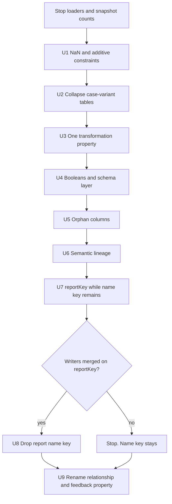

# Graph Model Integrity - Plan

## Goal Capsule

- **Objective:** A person asking the portal about lineage, and a person re-running the loaders, both still get a working system, and the graph no longer accepts a second schema, session, flat file, or case-variant table for the same real object.
- **Means:** Additive constraints and copy-then-cut data repairs, with writers updated in the same change as the names they emit (KTD1, KTD3).
- **Authority:** This plan, then `AGENTS.md` for loader and documentation rules, then the live `governancemetadata` counts captured before each write.
- **Execution profile:** Loaders are stopped during each graph write. The portal stays up for every unit except the gated report-name drop. Each unit is one commit on a feature branch and is reverted as a unit if its post-check fails.
- **Stop:** Stop the unit when a pre-check finds a null key, a duplicate the unit did not plan to merge, or a `CREATE CONSTRAINT` that the server rejects. Leave the previous unit's data in place. Do not continue to the next unit.
- **Ships:** The implementer. The user restarts the portal only after a unit that changes Cypher the portal emits.

## Product Contract

### Summary

Repair the live `governancemetadata` model and the loaders that write it, without a window where the portal or a re-run cannot use the graph. Documents that describe the model change in the same commit as the behavior they describe.

### Problem Frame

The graph already enforces uniqueness for tables, columns, and most business nouns. It does not enforce it for schemas, sessions, or flat files, and the table constraint is case-sensitive, so 130 tables are pairs of the same object. Forty-nine system descriptions are float `NaN`, which breaks JSON responses. Semantic lineage is missing on most semantic tables, and twenty semantic tables point straight at Replica. Two column properties, two flag encodings, and two names (`HAS_Product_Line`, `feedback_comment`) disagree with the rest of the model. Applying the review's constraint swaps by dropping the current uniqueness indexes would take the merge keys offline while the portal is still writing sessions.

### Key Decisions

- **Live graph and loaders both change.** Code-only prevention would leave the current bad nodes in place. Governs R1, R2, R4, R5, R6, R7. (session-settled: user-approved — chosen over a loader-only change: the current nodes are the defect.)
- **The running portal and the loaders keep working through the change.** A drop-and-recreate of the table or column uniqueness constraint is refused. Governs R1, R8. (session-settled: user-directed — chosen over applying the review DDL in one cutover: that cutover takes merge keys offline.)
- **A semantic table gains an upstream edge only when a source the loaders already trust names the parent.** Unproven tables stay as a counted gap. Governs R6. (session-settled: user-approved — chosen over inventing upstreams for the 2,176 semantic tables that have none.)
- **A report with a URL is identified by that URL. A report with no URL keeps its name.** Governs R7. (session-settled: user-approved — chosen over making `webUrl` the only key: 138 reports have no URL.)
- **Model documents change with the behavior.** Governs R9. (session-settled: user-directed — chosen over a code-only diff: the portal and the next loader run read those documents.)
- **The database is `governancemetadata`, using the project credentials.** Governs R1. (session-settled: user-directed — chosen over the instance default `neo4j` database.)

### Requirements

**Identity**

- R1. `:Schema`, `:FlatFile`, and `:Session` reject a second node with the same merge key. `:Table`, `:Column`, `:MasterDataDomain`, and `:RoleAssignment` reject a node whose merge key is null. Existing uniqueness indexes stay in place the whole time.
- R7. A Power BI report is merged on `reportKey`, which is its `webUrl` when that value is non-empty and `name:` plus its name otherwise. `Report_name_key` stays until every writer merges on `reportKey` and a separate gated step drops it.

**Data repairs**

- R2. Each case-variant table group collapses to one node. Relationships move onto the survivor before the loser is deleted. A loader re-run does not recreate the loser.
- R3. `DataSystem.description` is null or a string. No float `NaN` remains.
- R4. `Column.transformation` is the only transformation property writers set. Values that exist only on `transformations` are copied across before that property is removed.
- R5. `DataSystem.isSoxRelevant`, `DataSystem.isRecordActive`, and `Policy.isSoxRelevant` are booleans. Schema `layer` is set from `schema_layer()` wherever it is null and the function returns a layer.

**Lineage**

- R6. The twenty semantic tables that `DERIVED_FROM` a Replica table are rewired to a Gold or Silver parent when one is already in the graph or in a loader source. The Replica edge is removed only in the same transaction, after the replacement exists. Semantic tables with no provable parent are counted and left alone.

**Compatibility**

- R8. During and after every unit, `MERGE` on the current keys still finds the same nodes, `/ask` still answers a read-only lineage question, and a loader re-run does not create a duplicate schema, session, flat file, or case-variant table.

**Cleanup**

- R10. The two comma-joined orphan columns are deleted only after a check shows they have no relationships. `ETL.*` orphan columns are deleted only when no loader writes them. Otherwise the loader is fixed and they are left for a later load to own.
- R11. `HAS_Product_Line` is replaced by `HAS_PRODUCT_LINE`. `Message.feedback_comment` is replaced by `feedbackComment` on the graph. The SQLite archive column name stays `feedback_comment`.

**Documentation**

- R9. The same commit that changes a key, a property, a relationship type, or a constraint also updates every document and skill file that states the old shape.

### Success Criteria

- A reload of the loaders that previously created case-variant tables leaves the table count unchanged for those groups.
- A sample `/ask` lineage question returns rows and the response serializes to JSON.
- `SHOW CONSTRAINTS` includes the new schema, flat-file, and session keys, and still includes `Table_qualifiedName_key` and `Column_qualifiedName_key`.

### Scope Boundaries

- `layer` stays a property. Fact, Dimension, View, and Legacy stay extra labels.
- `BELONGS_TO`, `HOSTS`, `CONTAINS`, and `REPLICATED_TO` stay overloaded. No new relationship vocabulary.
- `:Message` stays an append-only event with no uniqueness constraint.
- `GRAPH TYPE` is out. This instance is Neo4j 2025.06.2 Enterprise.
- APOC is not installed for this work.
- Empty labels that already have keys (`BusinessTerm`, `SubBusinessArea`, `UseCase`, `TableSchemaVersion`) are left as they are.
- Person and DataSystem identity stay `name`. Report name stops being the only key only in the gated drop.

#### Deferred to Follow-Up Work

- Dropping `Report_name_key` if U7's gate fails because a writer still merges on `name`.
- Backfilling semantic `DERIVED_FROM` for tables whose parent is not in the graph or in a current loader source.
- Owning `ETL.*` columns with a pipeline relationship, if a loader still emits them after U5.

### Acceptance Examples

- AE1. Given two tables whose qualified names differ only by case, when U2 commits, then one node remains, its relationships are the union of both, and the deleted name is listed in the unit's before/after note. Covers R2, R8.
- AE2. Given a `DataSystem` whose description is float `NaN`, when U1 commits, then the property is null and a query result that includes that node serializes as JSON. Covers R3, R8.
- AE3. Given a semantic table whose only upstream is a Replica table and a Gold or Silver parent exists, when U6 commits, then the table derives from that parent and not from the Replica table. Given no such parent, the Replica edge remains and the table is in the gap count. Covers R6.
- AE4. Given the portal is running, when U7 adds `reportKey` and switches writers, then an existing report is still found by name and a new session still merges. Covers R7, R8.

### Sources

- Live review of `governancemetadata` on Neo4j 2025.06.2 Enterprise: 23 constraints, missing `Session_id_key`, 62 case-variant table groups (130 nodes), 49 float `NaN` descriptions, 2,176 of 2,788 semantic tables with no `DERIVED_FROM`, 20 semantic-to-Replica edges, 14 orphan columns, `transformation` on 4,096 columns and `transformations` on 245.
- `src/neo4j_loader.py` `canonicalize_table_qn` and `build_table_qn_lookup`.
- `src/data_model_merge_template.cypher` constraint block.
- `src/load_sttm.py` writes `transformation`. `src/load_phase4_metadata.py` writes `transformations`.
- Report merges on `name` in `src/load_reports.py`, `src/load_report_to_view.py`, `src/load_lineage.py`, `src/load_powerbi_lineage.py`, and `extract_data_from_system.py`.
- Portal prompt files: `.agents/skills/cypher-query-generator/SKILL.md` and `references/graph_schema.md`.

## Planning Contract

### Key Technical Decisions

- KTD1. **Add existence constraints beside uniqueness. Do not drop `Table_qualifiedName_key` or `Column_qualifiedName_key`.** Neo4j uniqueness does not reject nulls. An `IS NOT NULL` constraint on the same property does, and it does not replace the uniqueness index. A `NODE KEY` on that property would require dropping the uniqueness constraint first, which is the write gap R8 forbids. New `NODE KEY` constraints are created only for `:Schema`, `:FlatFile`, and `:Session`, which have no constraint today and whose keys were unique and non-null at review time. Governs R1, R8.
- KTD2. **Case folding uses the loader lookup, then relationship count.** `Neo4jLoader.canonicalize_table_qn` already returns the stored casing when one node exists. Where two nodes share a lower-cased name, the survivor is the one with more relationships. A tie keeps the name that is not the all-lowercase spelling of the object, then the lexicographically smaller qualified name. The loser is deleted only after its relationships are merged onto the survivor in the same transaction. Every table writer calls `canonicalize_table_qn` before `MERGE`. Governs R2, R8.
- KTD3. **`reportKey` is additive, and the name key drops only behind a gate.** Backfill `reportKey` on existing reports, add a uniqueness constraint on it, and switch every report `MERGE` to that property while `Report_name_key` still exists. The drop is a separate unit. It aborts if any runtime writer still merges `:Report` on `name`, or if the pre-check finds two reports that would share a name and that the user has not accepted as distinct. Governs R7, R8.
- KTD4. **`transformation` is the canonical column property.** `load_sttm.py` and `docs/medallion_architecture_graph_design.md` already use it. `load_phase4_metadata.py` is changed to write `transformation`. `transformations` is removed only after a query shows no node has a non-null `transformations` and a null `transformation`. Governs R4.
- KTD5. **Boolean conversion and the agent context land in one commit.** `Yes`/`No` map to true/false. `Y` maps to true. Null stays null. The portal skill files that describe these properties change in that same commit, so the next `/ask` does not compare a boolean to the string `Yes`. Governs R5, R9.
- KTD6. **Relationship and property renames are copy-then-cut.** Create `HAS_PRODUCT_LINE` parallel to the four `HAS_Product_Line` edges, update every query text to the new type, prove the new type returns four rows, then delete the old type. For messages, copy `feedback_comment` to `feedbackComment`, update `chat_history.py` to read the new property, and remove the old property. The SQLite column is untouched. Governs R11, R9.
- KTD7. **Lineage replacement is one transaction per table.** Create the Gold or Silver `DERIVED_FROM` edge, then delete the Replica edge. If no parent qualifies, write nothing for that table and add it to the gap count. Governs R6.

### High-Level Technical Design

Writers are stopped. Each unit captures counts, writes, checks counts, and updates the documents that mention what it changed. The portal keeps reading. It is restarted only after a unit that changes the Cypher it is prompted to emit (U4, U7's writer switch does not change read shapes, U8, U9).

### Sequencing

U1 through U7 run in order. U8 runs only when its gate passes. U9 runs after U7, and after U8 if U8 ran. U4, U8, and U9 are the units that require a portal restart before `/ask` is treated as proof.

### Assumptions

- Loaders are not running during a unit's write. The portal's session `MERGE` may run during U1. That is safe because session ids were unique at review time and the new constraint fails the write rather than creating a duplicate.
- An existence constraint and a uniqueness constraint may both exist on the same property on Neo4j 2025.06.2 Enterprise. U1 verifies this on `:FlatFile` first, which has one node. If the server rejects the pair, U1 stops and does not touch `:Table` or `:Column`.
- `schema_layer()` returns a layer for the eight schemaless schemas, or those eight stay null and are listed. The unit does not invent a layer.

### Risks

- A loader started mid-unit can recreate a case-variant table or a comma-joined column. Mitigation: loaders stay stopped until that unit's writer change is on the branch that will be used for the next load.
- Dropping `Report_name_key` lets two workspaces store the same report name. Mitigation: U8 is gated and abortable. Until it runs, current name uniqueness still holds.
- The portal prompt and the graph can disagree for the minutes between a graph rename and the restart. Mitigation: U9 keeps the old relationship until the new prompt is what the restarted portal loads. U4 converts flags only in the commit that also changes the prompt, and the restart happens before the next `/ask` check.

## Implementation Units

| U-ID | Title | Files | Depends on |
|---|---|---|---|
| U1 | Clear NaN and add constraints that do not replace existing ones | `src/data_model_merge_template.cypher`, schema docs | none |
| U2 | Collapse case-variant tables and make loaders case-fold | `src/neo4j_loader.py`, table loaders | U1 |
| U3 | One column transformation property | `src/load_phase4_metadata.py` | U2 |
| U4 | Boolean flags and missing schema layers | `src/load_datasystems.py`, portal skill | U1 |
| U5 | Remove ghost columns | column loaders | U3 |
| U6 | Rewire proven semantic lineage | lineage loaders | U2 |
| U7 | Add reportKey and switch writers | report loaders | U1 |
| U8 | Drop the report name key | template, skill | U7 gate |
| U9 | Rename the product-line relationship and feedback property | `chat_history.py`, skill, template | U7 |

### U1. Clear NaN and add constraints that do not replace existing ones

- **Goal:** Float `NaN` descriptions are gone, and schema, flat file, and session keys are enforced, without dropping a constraint that already exists.
- **Requirements:** R1, R3, R8, R9
- **Files:** `src/data_model_merge_template.cypher`, `llm_graph_cypher_query_generation_context.md`, `.agents/skills/cypher-query-generator/references/graph_schema.md`, `docs/medallion_architecture_graph_design.md`
- **Approach:** Snapshot constraint names and the 49 float descriptions. Set those descriptions to null. Create `Schema_qualifiedName_key`, `FlatFile_name_key`, and `Session_id_key` as `NODE KEY`. On `:FlatFile`, add an `IS NOT NULL` existence constraint under a new name only as the coexistence probe if a node-key already covers it. Skip that probe when the new node key already implies existence. Add `IS NOT NULL` existence constraints, under new names, for `Table.qualifiedName`, `Column.qualifiedName`, `MasterDataDomain.name`, and `RoleAssignment.type` plus `RoleAssignment.scope`. Add `idx_table_layer`. Put the same statements in the template. Do not drop `Table_qualifiedName_key`, `Column_qualifiedName_key`, `MasterDataDomain_name_key`, or `RoleAssignment_key`.
- **Patterns:** `CREATE CONSTRAINT ... IF NOT EXISTS` in `src/data_model_merge_template.cypher`. Pre/post counts from `AGENTS.md`.
- **Test scenarios:** A second `MERGE` of an existing schema qualified name matches the existing node. A `DataSystem` that had float `NaN` now has a null description and appears in a JSON-serialized read. `SHOW CONSTRAINTS` still lists `Table_qualifiedName_key` and also lists `Session_id_key`. Creating the table existence constraint is a no-op on the second run.
- **Verification:** Run the pre/post queries in the Verification Contract for U1. `pytest -q` from the repo root still passes, because this unit does not change loader Cypher constants unless the template is loaded by a test. If `tests/` explains Cypher from the template, that explain gate must pass.

### U2. Collapse case-variant tables and make loaders case-fold

- **Goal:** The 62 case-variant groups become 62 tables, and the next load does not split them again.
- **Requirements:** R2, R8, R9
- **Files:** `src/neo4j_loader.py`, `src/load_phase4_metadata.py`, `src/load_master_data.py`, `src/load_powerbi_lineage.py`, `src/load_lineage.py`, `src/load_tables.py`, `src/load_sttm.py`, and any other `src/load_*.py` that `MERGE`s `:Table` on `qualifiedName` without calling `canonicalize_table_qn`.
- **Approach:** Build the lower-case lookup. For each group of more than one stored name, pick the survivor by KTD2. In one transaction, `MERGE` each relationship of the loser onto the survivor, move labels the survivor lacks, copy properties the survivor lacks, and `DETACH DELETE` the loser. Record both names. Then route every table `MERGE` through `canonicalize_table_qn` so a later load hits the survivor.
- **Patterns:** `Neo4jLoader.build_table_qn_lookup` and `canonicalize_table_qn`. `load_master_data.py` already matches with `toLower`.
- **Test scenarios:** AE1. A group whose loser has a `HAS_COLUMN` the survivor lacks ends with that edge on the survivor. A second call of `canonicalize_table_qn` with the loser's old spelling returns the survivor's spelling. Table count drops by the number of losers, and relationship counts do not drop.
- **Verification:** Pre/post table count differs by the loser count. Pre/post counts for `HAS_COLUMN`, `DERIVED_FROM`, `CONTAINS`, and `CONSUMES` are equal or higher on the survivor side and the global relationship counts do not fall. Root `pytest -q`.

### U3. One column transformation property

- **Goal:** Writers set `transformation` only, and no value is stranded on `transformations`.
- **Requirements:** R4, R9
- **Files:** `src/load_phase4_metadata.py`, `src/load_sttm.py`, `docs/medallion_architecture_graph_design.md`, `llm_graph_cypher_query_generation_context.md`, `.agents/skills/cypher-query-generator/references/graph_schema.md`
- **Approach:** Where `transformations` is non-null and `transformation` is null, copy it. Where both are non-null and differ, keep `transformation` and record the conflict count. Change the phase-4 write to set `transformation`. Remove `transformations` only after the conflict count is zero or each conflict is listed and the copy rule has been applied. Update the docs that mention the property.
- **Patterns:** `load_sttm.py` already assigns `col.transformation`.
- **Test scenarios:** A column with only `transformations` ends with that string on `transformation` and no `transformations` property. A column with both different strings keeps `transformation` and the conflict is in the unit note. A phase-4 re-run sets `transformation` and does not set `transformations`.
- **Verification:** `MATCH (c:Column) WHERE c.transformations IS NOT NULL RETURN count(c)` is 0. Root `pytest -q`.

### U4. Boolean flags and missing schema layers

- **Goal:** The three flag properties are booleans, and schemas with a known layer have `layer` set, in the same commit as the prompt text that describes them.
- **Requirements:** R5, R8, R9
- **Files:** `src/load_datasystems.py`, `src/data_cleaning_utils/append_sharepoint_only_systems.py`, `src/data_cleaning_utils/merge_sharepoint_into_idp.py`, `src/medallion.py`, `src/data_model_merge_template.cypher`, `llm_graph_cypher_query_generation_context.md`, `.agents/skills/cypher-query-generator/references/graph_schema.md`, `.agents/skills/cypher-query-generator/SKILL.md`
- **Approach:** Map `Yes` and `Y` to true and `No` to false on the three properties. Leave null as null. Set `Schema.layer` from `schema_layer()` only where it is null. Add `IS :: BOOLEAN` type constraints only after the values match, and `IS :: STRING` on `DataSystem.description` only after U1. Update skill text so example predicates use booleans. Restart the portal before the `/ask` check.
- **Patterns:** `schema_layer()` in `src/medallion.py` is the only layer implementation. Loaders must not re-encode the flag table.
- **Test scenarios:** A system that was `isSoxRelevant = 'Yes'` reads back true. A system that was `isRecordActive = 'Y'` reads back true. A schema that had no layer and whose name matches a medallion rule now has that layer. An `/ask` question about SOX relevance still returns rows after the restart.
- **Verification:** `valueType` counts show boolean or null for the three flags. Root `pytest -q`. One read-only `/ask` after portal restart.

### U5. Remove ghost columns

- **Goal:** The comma-joined column names are gone, and they do not come back on the next load.
- **Requirements:** R10, R8
- **Files:** The loader that emitted the comma-joined qualified names. Search `src/load_sttm.py` and `src/load_lineage.py` first. Do not guess a second writer if the search finds one.
- **Approach:** For the two known comma-joined qualified names, delete the node only when it has degree 0. Find the writer that joined several fields into one qualified name and make it skip or split that cell the way `src/excel_cells.py` already requires. For `ETL.*` orphans, if a loader writes them, fix that loader so the next run attaches them or stops emitting them. If no loader writes them, delete the degree-0 nodes and list their names.
- **Patterns:** `excel_cells.split_multivalue` and the STTM positional pairing rule in `AGENTS.md`.
- **Test scenarios:** The two comma-joined names are absent. A fixture row that used to emit a comma-joined qualified name emits no `Column` for that cell, or emits one column per split value, matching the loader's existing pairing rule. Re-running the loader does not recreate the deleted names.
- **Verification:** The two qualified names return no node. Root `pytest -q`, including any loader parsing test that covers multi-value cells.

### U6. Rewire proven semantic lineage

- **Goal:** Semantic tables that point at Replica point at Gold or Silver when that parent is knowable, and every other gap is a number, not a guessed edge.
- **Requirements:** R6, R8, R9
- **Files:** `src/load_lineage.py`, `src/load_sttm.py`, `src/medallion.py`, `AGENTS.md` only if the lineage rule text changes. It should not. The rule already says semantic derives from Gold or Silver.
- **Approach:** For each of the twenty semantic-to-Replica edges, look for a Gold or Silver table that already has a `DERIVED_FROM` or `REPLICATED_TO` path from that Replica table, or that the STTM source names. If one parent qualifies, create `DERIVED_FROM` to it and delete the Replica edge in the same transaction. If none qualifies, leave the edge and count it. For semantic tables with no upstream, run the existing lineage loader path that can prove a parent. Do not `MERGE` an edge from a name that was inferred by trimming `_vw`. Publish the filled count and the remaining gap count in the unit note.
- **Patterns:** Layer comes from `schema_layer()`, not a new table in the loader.
- **Test scenarios:** AE3. A semantic table that already derives from a Gold table is unchanged. Global `DERIVED_FROM` count does not fall except by the Replica edges that were replaced one-for-one. No semantic table gains an edge to a node created in this unit.
- **Verification:** The pre/post query for semantic-to-Replica count. The gap count is written down. Root `pytest -q`.

### U7. Add reportKey and switch writers

- **Goal:** Reports merge on `reportKey` while name uniqueness still holds, so today's reports stay findable by name.
- **Requirements:** R7, R8, R9
- **Files:** `src/load_reports.py`, `src/load_report_to_view.py`, `src/load_lineage.py`, `src/load_powerbi_lineage.py`, `extract_data_from_system.py`, `src/data_model_merge_template.cypher`, `llm_graph_cypher_query_generation_context.md`, `.agents/skills/cypher-query-generator/references/graph_schema.md`
- **Approach:** Set `reportKey` to `webUrl` when `webUrl` is non-empty, otherwise to `name:` plus `name`. Create `Report_reportKey_key` as a node key. Change each report `MERGE` to `{reportKey: ...}` and keep setting `name` and `webUrl` as properties. Leave `Report_name_key` in place. Queries that match reports by name keep working.
- **Patterns:** `load_powerbi_lineage.py` already stores `webUrl` on create and on match.
- **Test scenarios:** AE4. A report with a URL gets `reportKey` equal to that URL. A report with no URL gets `reportKey` equal to `name:` plus its name. A second merge with the same URL matches the same node. Two reports still cannot share a name, because `Report_name_key` remains.
- **Verification:** `reportKey` is present on every report. `SHOW CONSTRAINTS` lists both `Report_name_key` and `Report_reportKey_key`. Root `pytest -q`.

### U8. Drop the report name key

- **Goal:** Two reports may share a display name when their URLs differ, and nothing that still merges on name is left running.
- **Requirements:** R7, R8, R9
- **Files:** `src/data_model_merge_template.cypher`, `.agents/skills/cypher-query-generator/references/graph_schema.md`, `.agents/skills/cypher-query-generator/SKILL.md`
- **Approach:** Abort without dropping the constraint if `rg` over `src/`, `extract_data_from_system.py`, and `neo4j_text2cypher_fullstack/backend` still finds a `:Report` merge map that keys on `name`. Abort if any report lacks `reportKey`. Stop the portal and the loaders. Drop `Report_name_key`. Restart the portal. If the drop succeeds and a smoke `/ask` fails, recreate `Report_name_key` from the template statement and stop.
- **Patterns:** The template's `IF NOT EXISTS` form is the rollback statement.
- **Test scenarios:** After the drop, two in-memory merges with the same name and different `reportKey` values would create two nodes. The smoke `/ask` that looks up a report by name still returns that report, because name is still a property. A merge path that still keys on `name` is absent from the tree, which is the abort case rather than a passing case.
- **Verification:** `SHOW CONSTRAINTS` has `Report_reportKey_key` and does not have `Report_name_key`. One `/ask` after restart returns rows. Root `pytest -q`.

### U9. Rename the product-line relationship and feedback property

- **Goal:** The graph uses `HAS_PRODUCT_LINE` and `feedbackComment`, and the portal prompt matches the graph before the old names disappear.
- **Requirements:** R11, R8, R9
- **Files:** `neo4j_text2cypher_fullstack/backend/app/database/chat_history.py`, `neo4j_text2cypher_fullstack/backend/app/generation/agent.py`, `.agents/skills/cypher-query-generator/SKILL.md`, `.agents/skills/cypher-query-generator/references/graph_schema.md`, `src/data_model_merge_template.cypher`, `docs/medallion_architecture_graph_design.md`, `README.md`, `llm_graph_cypher_query_generation_context.md`
- **Approach:** Create `HAS_PRODUCT_LINE` for each existing `HAS_Product_Line` edge. Update the skill, template, README, and medallion doc to the new type. Restart the portal and confirm a product-line question still resolves. Then delete `HAS_Product_Line`. For feedback, copy the property to `feedbackComment`, change the Neo4j read and write in `chat_history.py` to the new name, leave the SQLite column as `feedback_comment`, and remove the old graph property only after a read of `feedbackComment` returns the previous values.
- **Patterns:** Copy-then-cut from KTD6. Portal prompt assembly in `agent.py` `_skill_prompt`.
- **Test scenarios:** Four `HAS_PRODUCT_LINE` edges exist before the old type is deleted. A product-line `/ask` returns the same four pairs after restart. A message that had `feedback_comment` reads back the same text from `feedbackComment`. The SQLite archive insert still uses the column `feedback_comment`.
- **Verification:** Relationship count query for both types, then only the new type. Backend `pytest -q` from `neo4j_text2cypher_fullstack/backend`. One `/ask` after restart.

## Verification Contract

Run from the repo root unless noted. The Python executable is `.venv\Scripts\python.exe`.

| Check | Command or query | Applies |
|---|---|---|
| Loader and rule tests | `.venv\Scripts\python.exe -m pytest -q` | U1–U8 |
| Portal tests | `.venv\Scripts\python.exe -m pytest -q` from `neo4j_text2cypher_fullstack/backend` | U4, U7, U8, U9 |
| Constraint inventory | `SHOW CONSTRAINTS YIELD name, type, labelsOrTypes, properties RETURN name, type, labelsOrTypes, properties ORDER BY name` | U1, U7, U8 |
| NaN gone | `MATCH (d:DataSystem) WHERE valueType(d.description) STARTS WITH 'FLOAT' RETURN count(d)` equals 0 | U1 |
| Case groups gone | `MATCH (t:Table) WITH toLower(t.qualifiedName) AS q, count(*) AS c WHERE c > 1 RETURN count(*)` equals 0 | U2 |
| Semantic-to-Replica | `MATCH (v:Table {layer:'Semantic'})-[:DERIVED_FROM]->(s:Table {layer:'Replica'}) RETURN count(*)` plus the written gap count | U6 |
| Ask smoke | One read-only lineage question against `governancemetadata` after the portal restart | U4, U8, U9 |

`pnpm test:e2e` is required only when the frontend, backend on port 8000, and Neo4j are already up for that unit's restart. A unit that does not restart the portal does not need the browser suite.

Live writes use the pre/post pattern in `AGENTS.md`. Capture the count, apply the unit, assert the after state. Do not declare a unit done on an empty error log.

## Definition of Done

- R1 through R11 hold, with R7's name-key drop either done or explicitly stopped at the U8 gate and recorded in the unit note.
- U6's gap count is written in the commit message or the unit note. A silent zero is not acceptable unless the query really returned zero.
- `Table_qualifiedName_key` and `Column_qualifiedName_key` still exist.
- The documents listed on each unit match the graph the unit left behind.
- Root `pytest -q` passes. Backend `pytest -q` passes after U9.
- Scratch scripts created to run a unit are deleted.
- No abandoned migration helper remains in `src/` or `neo4j_text2cypher_fullstack/backend`.
